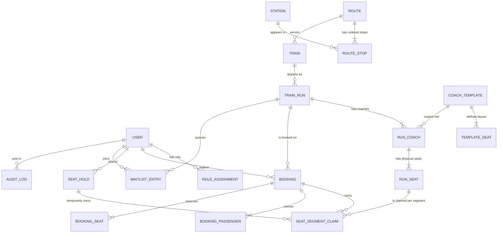

# RAILVYN — PPT Prompt & Easy Project Notes

> This file has two parts:
> 1. **A ready-to-copy prompt** you can paste into any AI presentation tool (ChatGPT / Claude / Gamma / Canva AI / Google Slides AI) to generate a **7–8 slide PPT** with an **ER diagram**.
> 2. **Easy notes about the project**, so any team member can explain the slides in viva or in front of the class.

---

## 1. Quick project facts (read this first)

| Item | Detail |
|---|---|
| **Project name** | RAILVYN |
| **Tagline** | *Every journey. Precisely placed.* |
| **Full form / meaning** | Railway + "vy" (brand word). It is a **Railway Coach & Dynamic Seat Allocation System**. |
| **Type** | Web application (responsive), database-first |
| **Main idea** | A seat is booked **only for the part of the journey you travel**, not the whole route. So one seat can be sold again after a passenger gets down — but never on the same segment twice. |
| **Not** | Not IRCTC, not Indian Railways, not an official PNR system, no real payment. It is an **educational / demo project**. |
| **Database size in demo** | 27 tables, about **1,000 stations, 1,420 routes, ~10,000 train runs, ~1.35 million seats** (seeded demo data) |
| **Deployment** | Vercel (Node.js runtime) + Neon PostgreSQL |

### Team members

| Name | Roll number | Suggested slides to present |
|---|---|---|
| **Shiuli Chakraborty** | BWU/BTS/25/04 | Slide 1, 2 |
| **Anushka Rahaman** | BWU/BTS/25/08 | Slide 3, 4 |
| **Sushmita Das** | BWU/BTS/25/01 | Slide 5, 6 (ER diagram + core logic) |
| **Sathi Dalal** | BWU/BTS/25/12 | Slide 7, 8 (flow, results, thank you) |

---

## 2. Copy-paste prompt for the PPT

Copy everything between **PROMPT START** and **PROMPT END** and paste it into the AI tool.

````text
PROMPT START

You are an expert presentation designer. Create a clean, professional, academic
project presentation of EXACTLY 7 slides (add 1 extra "Thank You" slide only if
the tool requires a closing slide, making 8 total). Use simple, clear English
suitable for a college final-year project presentation.

PROJECT DETAILS
- Project name: RAILVYN
- Tagline: "Every journey. Precisely placed."
- Type: Railway Coach & Dynamic Seat Allocation System (web application)
- It is a database-first demo/educational project. It is NOT IRCTC, NOT Indian
  Railways, and does NOT generate official PNRs or take real payments. State this
  honestly in a small footnote on the title slide.
- Team members (show on the title slide):
    Shiuli Chakraborty - BWU/BTS/25/04
    Anushka Rahaman  - BWU/BTS/25/08
    Sushmita Das     - BWU/BTS/25/01
    Sathi Dalal      - BWU/BTS/25/12
- Tech stack: Next.js 16 (App Router) + React 19 + TypeScript, Tailwind CSS 4
  with Radix/shadcn components, PostgreSQL (Neon) with Drizzle ORM and versioned
  migrations, Better Auth for login/sessions/roles, Zod validation, TanStack Table,
  Recharts charts, Vitest + Playwright tests, deployed on Vercel.

SLIDE PLAN (follow exactly)

SLIDE 1 - TITLE
- Big title: RAILVYN
- Subtitle: Railway Coach & Dynamic Seat Allocation System
- Tagline: Every journey. Precisely placed.
- Team member names with roll numbers (4 members, in 4 neat cards)
- Small footnote: "Academic demo project. Not affiliated with Indian Railways/IRCTC."

SLIDE 2 - PROBLEM & OBJECTIVE
Left side "Problem" (3 short points):
  1. In normal reservation systems a seat is blocked for the whole route, so it
     stays empty after a passenger gets down.
  2. Without journey-aware checking, the same seat can be double-booked on
     overlapping parts of the journey.
  3. Passengers cannot see which exact seat and berth type is free for their own
     station-to-station leg.
Right side "Our Objective" (3 short points):
  1. Book a seat only for the segments the passenger actually travels.
  2. Reuse that seat for later passengers safely, with zero double booking.
  3. Give a clear coach/berth map, timed holds and waitlist handling.

SLIDE 3 - KEY FEATURES (3 columns by user role)
- Passenger: search trains by station + date, see stop timeline, interactive
  coach/seat map with berth types, short timed hold (5 minutes), demo checkout,
  RAILVYN booking reference, cancel booking, join waitlist.
- Operator: only their assigned trains, coach-by-coach and segment-by-segment
  occupancy, live holds, booking registry, seat reassignment, waitlist queue,
  disruption log.
- Admin: manage stations, routes and stop order, trains, schedules, coach
  templates, fares, users and roles, analytics dashboard, audit log.

SLIDE 4 - SYSTEM ARCHITECTURE & TECH STACK
- Draw a simple 3-layer architecture diagram with arrows:
  Browser (Next.js + React UI)
     -> Server (server actions / route handlers, domain services, Zod validation,
        Better Auth role check)
        -> Database (Neon PostgreSQL, Drizzle ORM, transactions, unique constraints)
- Add a small technology chip list: Next.js, React, TypeScript, Tailwind,
  PostgreSQL/Neon, Drizzle ORM, Better Auth, Recharts, Vitest, Playwright, Vercel.
- One line: "All authorization and inventory writes happen on the server only."

SLIDE 5 - ER DIAGRAM (most important slide)
- Title: "Database Design - Entity Relationship Diagram"
- Draw a clear ER diagram with 10-12 main entities and labelled relationships:
  USER, ROLE_ASSIGNMENT, STATION, ROUTE, ROUTE_STOP, TRAIN, TRAIN_RUN,
  COACH_TEMPLATE, RUN_COACH, RUN_SEAT, BOOKING, BOOKING_PASSENGER,
  SEAT_HOLD, SEAT_SEGMENT_CLAIM, WAITLIST_ENTRY, AUDIT_LOG.
- Use crow's-foot notation and show primary keys. Keep it readable: max 12 boxes,
  grouped in 3 visual bands:
  (a) Network: STATION, ROUTE, ROUTE_STOP, TRAIN, TRAIN_RUN
  (b) Inventory: COACH_TEMPLATE, RUN_COACH, RUN_SEAT
  (c) Booking: USER, SEAT_HOLD, BOOKING, BOOKING_PASSENGER, SEAT_SEGMENT_CLAIM
- Highlight SEAT_SEGMENT_CLAIM in a different colour and label it
  "heart of the system - one row per seat per segment, UNIQUE(run_seat_id, segment_index)".
- Small caption: "27 tables in total; 12 core entities shown."

SLIDE 6 - CORE LOGIC: JOURNEY-AWARE SEAT ALLOCATION
- Show a simple route line: A(0) --- B(1) --- C(2) --- D(3)
- Example 1: Seat 12 booked A -> C, so it claims segments 0 and 1.
- Example 2: New passenger wants C -> D, needs only segment 2, so Seat 12 is
  REUSED for this passenger. Allowed.
- Example 3: Another passenger wants B -> D, needs segments 1 and 2. Segment 1 is
  already taken, so the system REJECTS it and offers another seat.
- Show the booking steps as a small numbered flow:
  validate -> open transaction -> clean expired holds -> insert hold + claims ->
  unique conflict retry -> confirm booking + convert claims -> generate RAILVYN reference.
- Add note: "Hold expires in 5 minutes; server always re-checks at confirmation time."

SLIDE 7 - WORKING FLOW & RESULTS
- Horizontal user journey: Search -> Select run & leg -> Coach/seat map -> Hold
  (timer) -> Demo payment -> Booking reference -> My bookings / Cancel.
- Side box "Demo data scale": 1,000 stations, 1,420 routes, ~9,940 runs,
  ~1.35 million physical seats, 1,200 bookings.
- Side box "Quality": TypeScript strict, lint passing, database integration tests,
  Playwright end-to-end tests, WCAG 2.2 AA accessible seat map with keyboard support.
- Mention cancellation: releases claims -> creates audit entry -> promotes the
  oldest waitlisted passenger.

SLIDE 8 - CONCLUSION (this can be the last slide, or add a 9th "Thank You")
- Achievements: journey-aware inventory, no double booking under concurrency,
  three role-based dashboards, real analytics from the database.
- Limitations: demo payments only, no live railway data, no official PNR.
- Future scope: real payment gateway with webhook verification, mobile app,
  dynamic pricing, QR ticket, SMS/email alerts.
- End with "Thank You" and the 4 team member names.

DESIGN RULES
- Colour theme: matte black (#080A09) and soft ivory (#F7F8F3) with lime-green
  accent (#DAF28F) and dark green text (#263416). Use these as the only accent.
- Font: clean sans-serif (Inter, Poppins or Geist). Maximum 6 bullet points per
  slide, maximum 8 words per bullet.
- Big slide titles, generous white space, no clip-art, no long paragraphs.
- Use icons (train, seat, calendar, shield, database, chart) instead of emojis.
- Every slide must have a slide number and a small "RAILVYN" footer.
- Diagrams must be drawn as clean vector shapes with straight arrows and labels;
  do not use screenshots.
- Keep all text editable (real text boxes, not images of text).

OUTPUT
- 16:9 widescreen slides.
- Give speaker notes of 3-4 sentences for each slide.
- Export-ready for PowerPoint / Google Slides.

PROMPT END
````

---

## 3. Slide content written out (if you want to build it yourself)

### Slide 1 — Title

- **RAILVYN**
- Railway Coach & Dynamic Seat Allocation System
- *Every journey. Precisely placed.*
- Shiuli Chakraborty — BWU/BTS/25/04 · Anushka Rahaman — BWU/BTS/25/08 · Sushmita Das — BWU/BTS/25/01 · Sathi Dalal — BWU/BTS/25/12
- Footnote: *Academic demo project. Not affiliated with Indian Railways or IRCTC. No real payments.*

### Slide 2 — Problem & Objective

**Problem**

1. Seats are locked for the full route and stay empty after a passenger alights.
2. Overlapping segments can be sold twice if availability is not segment-aware.
3. Passengers cannot see which berth is free for *their* exact station pair.

**Objective**

1. Sell a seat only for the travelled segments.
2. Reuse seats safely with no double booking.
3. Provide a clear coach map, timed holds and a waitlist.

### Slide 3 — Key features by role

| Passenger | Operator | Admin |
|---|---|---|
| Search by station + date | Only assigned runs | Stations, routes, stop order |
| Stop timeline + fares | Coach × segment occupancy | Trains, schedules, runs |
| Interactive seat/berth map | Live holds + booking registry | Coach templates |
| 5-minute timed hold | Guarded seat reassignment | Fares, users and roles |
| Demo checkout + reference | Waitlist queue | Analytics + audit log |
| Cancel, waitlist | Disruption log | System settings |

### Slide 4 — Architecture (draw 3 layers)

```
[ Browser ]  Next.js 16 App Router + React 19 + Tailwind/Radix UI
      |
      v  (server actions / route handlers, Zod validation, auth + RBAC)
[ Server ]   Domain services: allocation · availability · fare · waitlist · audit
      |
      v  (Drizzle ORM, SQL transactions, row locks, unique constraints)
[ Database ] Neon PostgreSQL — 27 tables, versioned migrations
```

One-liner for the slide: **“The browser never writes inventory. Every claim is created inside a server transaction.”**

### Slide 5 — ER diagram

Use this Mermaid code (paste into mermaid.live, draw.io, or ask the AI tool to redraw it):



Simple text version (easy to redraw with boxes in PowerPoint):

```
 STATION ──< ROUTE_STOP >── ROUTE ──< TRAIN ──< TRAIN_RUN
                                                  │
                        ┌─────────────────────────┼───────────────────────┐
                        │                         │                       │
                   RUN_COACH                 BOOKING                WAITLIST_ENTRY
                        │                    (reference)                   │
                  RUN_SEAT ──< SEAT_SEGMENT_CLAIM >── BOOKING_SEAT     USER ──< ROLE_ASSIGNMENT
                                             │
                                        SEAT_HOLD (5-min timer)      AUDIT_LOG
```

What to **say** while showing the ER diagram (easy script):

> “The network side has stations, routes and ordered stops. A train runs on a route, and every dated departure is a train run. A train run gets coaches, and each coach gets physical seats for that date. The booking side is the important part: one **booking** has passengers, and the seat is not blocked as a whole — instead we insert one **segment claim** row for every small segment of the journey. A unique key on seat + segment makes double booking impossible at database level.”

### Slide 6 — Journey-aware allocation

Route: **A(0) → B(1) → C(2) → D(3)** — segments are `[0,1)`, `[1,2)`, `[2,3)`.

| Scenario | Segments needed | Result |
|---|---|---|
| P1 books A→C | 0, 1 | Seat 12 claimed on segments 0 and 1 |
| P2 books C→D | 2 | **Allowed** — seat reuse after alighting |
| P3 books B→D | 1, 2 | **Rejected** — segment 1 already claimed |

Booking transaction (say it in this order):

1. Validate run, stops, class, fare, passengers and user on the server.
2. Start a PostgreSQL transaction; clean expired holds **under lock**.
3. Insert the hold and one claim per segment; on unique conflict retry with another seat.
4. Hold lasts 5 minutes. At checkout the hold must still be valid.
5. Confirm booking + move claims from hold to booking in the same transaction.
6. Generate an internal **RAILVYN reference** (never called a PNR).

### Slide 7 — Demo flow, scale and quality

Search → Run details → Coach map → Hold → Demo checkout → Reference → Cancel / Waitlist

- Scale (seeded demo data): ~1,000 stations · 1,420 routes · ~9,940 runs · ~1.35 M seats · 1,200 bookings · 1,200 waitlist entries
- Quality: strict TypeScript, ESLint, unit + PostgreSQL integration tests, Playwright E2E, accessible seat map (keyboard + screen reader), works from 320 px
- Cancellation is idempotent: releases claims → audit entry → promotes the oldest matching waitlist entry

### Slide 8 — Conclusion & future scope (optional 8th page)

- **Achieved:** journey-aware inventory, safe seat reuse, no double allocation under concurrency, three role-based dashboards, real database analytics.
- **Limitations:** demo payments only, no live railway data, no official PNR.
- **Future:** real payment gateway with webhook verification, mobile app, dynamic pricing, QR tickets, notifications.
- **Thank you** + team names.

---

## 4. Easy word list (use these if a teacher asks)

| Term | Easy meaning |
|---|---|
| **Segment** | The small part between two neighbouring stations. Route A-B-C-D has 3 segments. |
| **Claim** | A database row that says “this seat is taken on this small segment”. |
| **Hold** | A temporary 5-minute reservation before payment. |
| **Waitlist** | A first-come-first-served queue for a full class on a full leg. |
| **Transaction** | A group of database steps that either all succeed or all fail. |
| **Row lock** | A database rule that stops two users editing the same row at the same time. |
| **Unique constraint** | Database rule: the same seat + same segment cannot be saved twice. |
| **RBAC** | Role-based access control — passenger / operator / admin see only what they are allowed to. |
| **Migration** | A versioned SQL file that changes the database structure. |
| **Idempotent** | Doing the same action again does not create a duplicate result. |
| **Reassignment** | Operator safely moves a booked passenger to another seat. |

---

## 5. Presentation tips

1. Use **at most 6 bullets** per slide and keep them **under 8 words**.
2. Show the **ER diagram slide for the longest time** — it carries the most marks.
3. Redraw the ER diagram in draw.io or PowerPoint shapes so it stays sharp and editable; do not screenshot the app for it.
4. Use numbers from the project (27 tables, 5-minute hold, 1.35 M seats) — real numbers look stronger than adjectives.
5. Say “**RAILVYN booking reference**”, never “PNR”. Say “**demo checkout**”, never “payment”.
6. Keep a small footer on every slide: `RAILVYN · Academic demo · not IRCTC`.
7. Time split for a 10-minute talk: 1 min title, 2 min problem/objective, 2 min features, 2 min ER diagram + logic, 2 min demo flow, 1 min conclusion.
